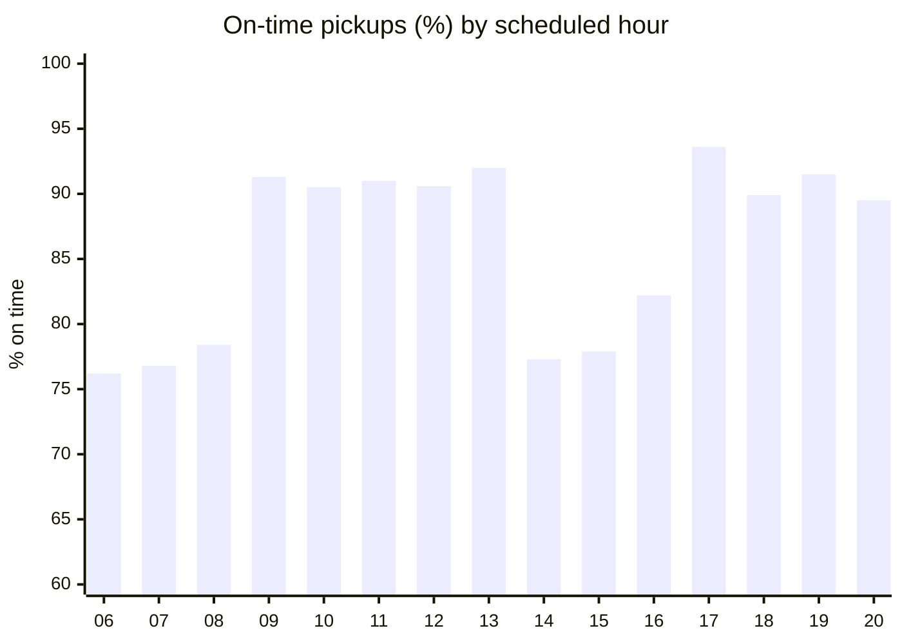
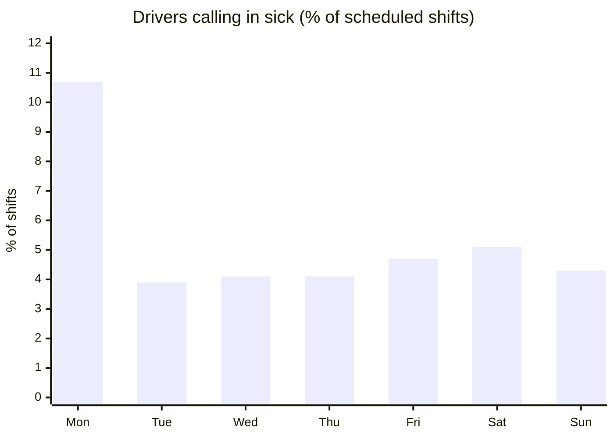

# 🚐 Paratransit Dispatch Analysis

**What makes specialized-transit pickups run late, and what can dispatch control?**

> ⚠️ **Sample data.** All drivers, vehicles, trips and incidents are **synthetic**, modelled on the kind of daily dispatch operation I work in on a regional paratransit contract (152 drivers, Durham Region). No real rider, driver or company data is included.

**Tools:** SQL (SQLite) · Excel

---

## Key results

- **83.5% of completed pickups were on time** (within 15 minutes) across 14,630 trips in 4 weeks.
- **Peaks drive most lateness:** on-time drops to **77.6%** in the morning and afternoon peaks, versus **91.2%** off-peak.
- **Mondays are the weak spot:** **10.7%** of scheduled drivers call in sick on Mondays, versus about 4% on other weekdays. Monday on-time falls to **64.3%**, versus **87.0%** Tuesday to Friday.
- **Short-staffed days run late:** weekdays with 10 or more sick calls averaged **66.4%** on time, versus **88.8%** with 6 or fewer.
- **Older vans break down 3 times as often:** 2016–2018 vehicles averaged **1.14** breakdowns each over the 4 weeks, versus **0.38** for 2022–2024 vehicles. Breakdowns cost **158 vehicle-hours** out of service.
- **North Durham** (rural) trips are on time only **65.7%** of the time, versus about 85–86% in the urban zones.

Full write-up: **[FINDINGS.md](FINDINGS.md)**

---

## Results

### On-time pickups by hour of day

### Sick calls by day of week

### Staffing and breakdowns vs on-time performance (weekdays)

| Condition | Weekdays | Avg on-time % |
|---|---|---|
| 0–6 sick calls | 13 | **88.8%** |
| 7–9 sick calls | 2 | 80.5% |
| 10+ sick calls | 5 | **66.4%** |
| 0–1 breakdowns | 9 | 85.8% |
| 2+ breakdowns | 11 | 79.6% |

### On-time % by zone

| Zone | Completed trips | On-time % | Avg delay (min) |
|---|---|---|---|
| North Durham | 1,021 | **65.7%** | 14.3 |
| Clarington | 1,420 | 78.8% | 11.0 |
| Whitby | 2,975 | 85.2% | 8.8 |
| Oshawa | 4,131 | 85.6% | 8.7 |
| Pickering | 2,483 | 85.7% | 8.6 |
| Ajax | 2,600 | 85.8% | 8.6 |

### Breakdowns by vehicle age

| Model years | Vehicles | Breakdowns | Per vehicle |
|---|---|---|---|
| 2016–2018 | 14 | 16 | **1.14** |
| 2019–2021 | 17 | 12 | 0.71 |
| 2022–2024 | 29 | 11 | 0.38 |

Other results: wheelchair trips ran slightly later than ambulatory ones (81.3% vs 84.8% on time); no-shows were 3.8% and late cancellations 6.1% of bookings.

---

## The data

| Table | Rows | One row = |
|---|---|---|
| `drivers` | 152 | a driver: shift type (AM / PM / Split), hire date |
| `vehicles` | 60 | a vehicle: accessible minivan or sedan, model year |
| `driver_shifts` | 2,952 | one driver scheduled on one day: worked or called in sick |
| `vehicle_incidents` | 46 | a breakdown, switch-out or minor collision and time out of service |
| `trips` | 16,228 | one booked trip: scheduled vs actual pickup, zone, type, status |

Period: September 1–28, 2025 (synthetic). On-time = picked up no more than 15 minutes after the scheduled time.

## How to reproduce

1. Install **[DB Browser for SQLite](https://sqlitebrowser.org/)** (free).
2. Follow the steps at the top of `sql/00_create_database.sql` to build the database from `data/`.
3. Run `sql/01_analysis.sql`, one query at a time.
